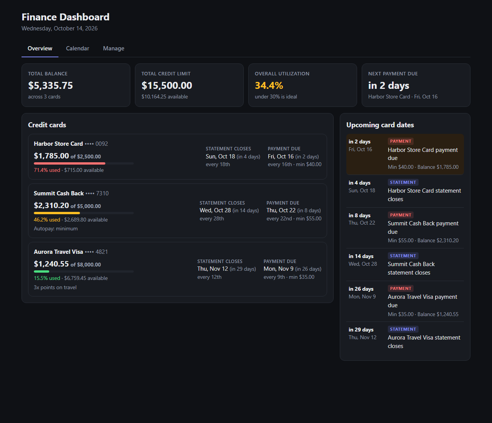
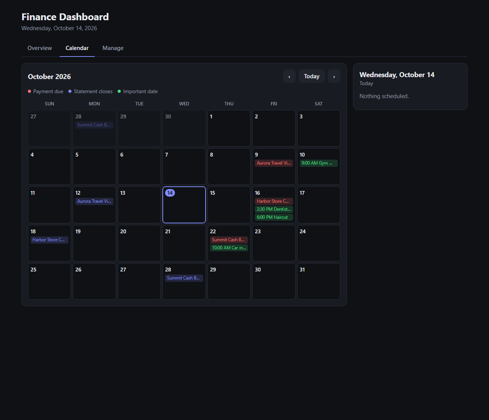

# Finance Dashboard

| Overview | Calendar |
|---|---|
|  |  |

*Screenshots use made-up example data.*

A local dashboard for tracking credit card balances, statement/due dates, and important dates.

Everything runs on your machine. Data is stored in `data/db.json` (git-ignored), and the
server only listens on `127.0.0.1`, so nothing is reachable from your network.

## Tech stack

- **Frontend:** React + Vite
- **Backend:** Node.js (local server on 127.0.0.1)
- **Storage:** JSON file (`data/db.json`, git-ignored)

  
## Run it

```bash
npm install     # first time only
npm run dev     # then open http://127.0.0.1:5173
```

`npm start` builds the app and serves everything from a single server at http://127.0.0.1:3001.

## Features

The app has three tabs:

- **Overview**: total balance, total credit limit, overall utilization, and the next payment
  due, plus each card's balance, utilization, available credit, minimum payment, and next
  statement and due dates, and a list of upcoming card dates.
- **Calendar**: a month view with every card's payment due date and statement closing date
  (repeated each month) and your important dates. Click a day to see its details.
- **Manage**: add, edit, and delete cards and important dates (with optional times).

## Roadmap

- [x] Manual entry for card balance, limit, and minimum payment
- [x] Combined 30-day timeline for payments, statements, and important dates
- [x] Calendar view with recurring payment and statement dates
- [ ] Pull card data automatically with the Plaid API
- [ ] Demo mode with sample data, so it can be hosted publicly
- [ ] Deploy a live demo
- [ ] Mobile app version
- [ ] Performance improvements and bug fixes

